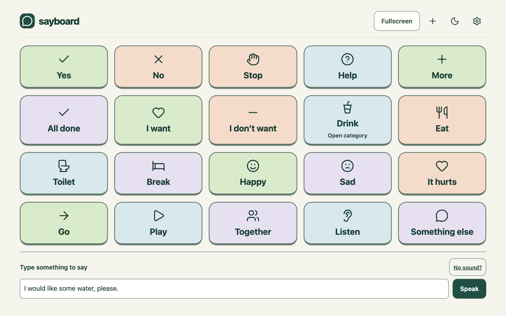

# Sayboard

Sayboard is a free, open-source AAC communication board. Tap a word or symbol to speak, or type a message to say. Create categories and arrange tiles with the person who uses the board.



Use the free app at [sayboard.org](https://sayboard.org). It works without an account. Boards save on the current device, and JSON import and export remain free.

The [teacher pilot](https://classroom.sayboard.org/teacher) adds classrooms, learner aliases, board drafts, published versions and device linking. Pair each learner's device once, then publish updates from the teacher dashboard. Linked devices save and apply publications automatically when communication is idle, and report receipt to the teacher. The pilot is invite-only. Organisers can email private invitations, and teachers choose their own passwords. The dashboard, authentication and database all run on a standalone VPS. All product code stays open source, and official hosting prices will follow the pilot. See [the pilot workflow](docs/TEACHER-PILOT.md).

## Run locally

Use Node 24 LTS, npm and Python 3.

```sh
npm ci --ignore-scripts
npm run dev -- --port 5188
```

Open `http://127.0.0.1:5188`. No account, API key or environment file is needed.

## Run on your own server

The default server uses Node and SQLite behind an HTTPS reverse proxy. It needs no managed database, cloud authentication service or hosting-platform SDK. Docker Compose and direct Linux deployment instructions are in [SELF-HOSTING.md](docs/SELF-HOSTING.md).

For a static build, run `npm run build` and serve all of `dist/`, including `/source/`. The build downloads pinned dependency sources and verifies their hashes. On the standalone server, published source archives persist across upgrades in the data volume.

## Privacy and practical limits

Boards stay in this browser unless you explicitly export a file or save an account copy. Signing in does not upload vocabulary. The app has no analytics or speech-history collection. Speech uses a device voice or an optional downloaded local model. The browser reports whether a device voice is local; actual sound and offline support depend on the device and browser.

Browser storage can be cleared or evicted. Export before changing devices, browser profiles or website addresses. Caregiver controls prevent accidental editing and are not a security lock.

This is a prototype, not a clinically validated AAC system. Keep the person's established communication tools available. Specialised access methods such as switch scanning have not been implemented.

## Develop and contribute

See [CONTRIBUTING.md](CONTRIBUTING.md), [the architecture](docs/ARCHITECTURE.md), [the project plan](docs/PROJECT.md) and [the board format](CATEGORIES-CONTRACT.md). Report vulnerabilities through [SECURITY.md](SECURITY.md), using synthetic data in all public evidence.

```sh
npm run lint
npm run typecheck
npm test
npm run --prefix backend check
npm run build
npm run build:server
npm run check:public
```

## Licence

Original app and server code uses GPL-3.0-or-later. Original browser modules also retain the additional permission in `LICENSE-OWNER-MIT`. Third-party terms remain applicable. See [LICENSING.md](LICENSING.md) and [THIRD-PARTY-NOTICES.md](THIRD-PARTY-NOTICES.md). You may self-host or offer your own hosting under those terms.
